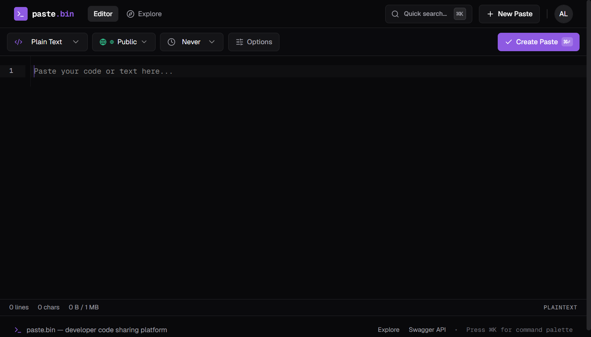
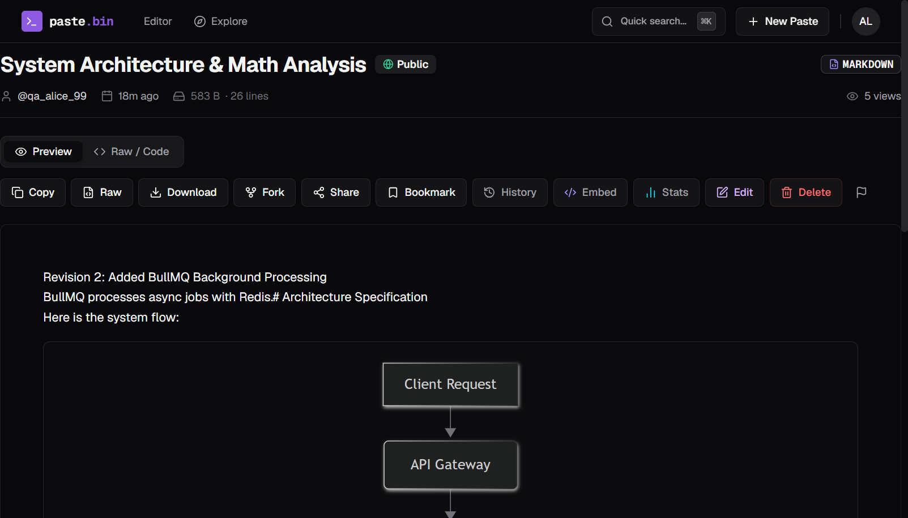
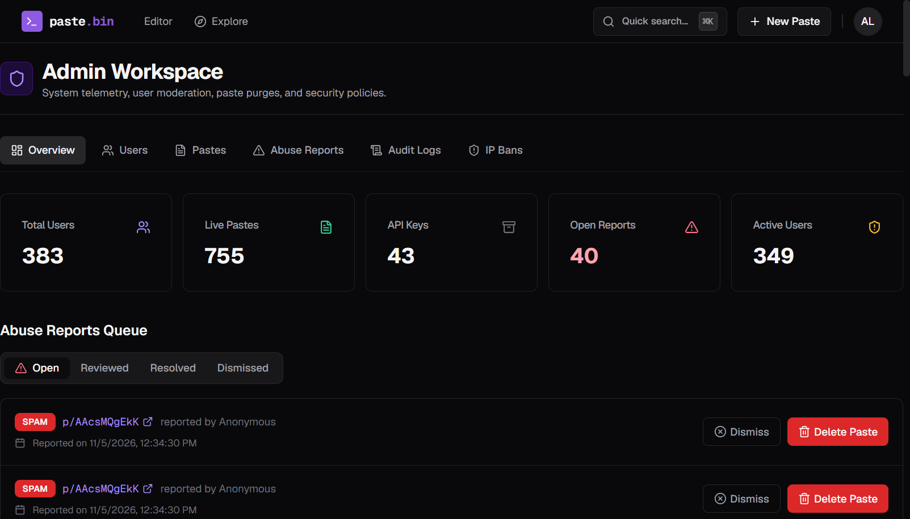

# Paste

[](https://github.com/himanshu-gunwant/Paste/actions/workflows/ci.yml)
[](https://nodejs.org/)
[](https://www.typescriptlang.org/)
[](https://nextjs.org/)
[](https://expressjs.com/)
[](https://www.postgresql.org/)
[](https://redis.io/)
[](LICENSE)

A modern, production-grade, open-source pastebin platform built with **TypeScript strict mode**, featuring a high-performance **Express 5 modular monolith backend** and a reactive **Next.js 15 (App Router) frontend**.

Designed for privacy, speed, and reliability, Paste provides instant code sharing, client-side token vaulting, Argon2id password protection, burn-after-reading with atomic consumption guarantees, snapshot revision histories with visual diffing, a developer API with daily quotas and idempotency keys, and moderation tools.

---

## Table of Contents

- [Problem & Motivation](#problem--motivation)
- [Key Features](#key-features)
- [Screenshots](#screenshots)
- [Technology Stack](#technology-stack)
- [Architecture Overview](#architecture-overview)
- [Repository Layout](#repository-layout)
- [Prerequisites](#prerequisites)
- [Quick Start (Local Development)](#quick-start-local-development)
  - [1. Backend Setup](#1-backend-setup)
  - [2. Frontend Setup](#2-frontend-setup)
- [Turnkey Production Deployment (Docker Compose)](#turnkey-production-deployment-docker-compose)
- [Environment Configuration Reference](#environment-configuration-reference)
  - [Backend Environment Variables](#backend-environment-variables)
  - [Frontend Environment Variables](#frontend-environment-variables)
  - [Production Compose Variables](#production-compose-variables)
- [Quality Assurance & Testing](#quality-assurance--testing)
- [API Overview](#api-overview)
- [Security & Privacy Architecture](#security--privacy-architecture)
- [Troubleshooting & FAQ](#troubleshooting--faq)
- [Contributing](#contributing)
- [License](#license)

---

## Problem & Motivation

Public paste services frequently suffer from slow load times, invasive tracking, lack of privacy controls, and fragile infrastructure. Paste is engineered as a self-hostable, developer-friendly alternative that treats code snippets and text as first-class citizens:

* **Zero Lock-In:** Deploy anywhere using standard containers or a single lightweight VPS.
* **Deterministic Privacy:** Visibility rules are enforced at the service layer, not through obscured URLs.
* **Atomic Security:** Burn-after-reading pastes are guarded by single-query atomic database updates to prevent race-condition disclosures.
* **Developer First:** Built-in OpenAPI 3.1 documentation, hashed API keys, request-correlation tracing, and idempotent creation endpoints.

---

## Key Features

* **Instant Code Editor:** CodeMirror 6 with line numbers, bracket matching, syntax detection for 15+ languages, line count, character count, and byte size indicators.
* **Privacy & Access Matrix:** Support for `PUBLIC`, `UNLISTED`, and `PRIVATE` pastes, plus temporary share tokens with max-use and expiration limits.
* **Argon2id Password Protection:** Salted, hashed password gates with constant-time verification preventing timing side-channel attacks.
* **Burn-After-Reading:** Pastes deleted atomically upon first consumption (`burnAfterRead = true`).
* **Anonymous Paste Vault:** Anonymous creators receive a cryptographically random management token stored in browser `localStorage`, granting edit/delete capabilities without requiring account creation.
* **Snapshot Revisions & Diffing:** Capped at 20 snapshots per paste, with visual side-by-side and unified diff viewers and one-click rollback.
* **Developer API:** Bearer-authenticated API keys (`pb_...`), configurable daily rate limits, quota enforcement, and `Idempotency-Key` replay protection.
* **Discovery & Full-Text Search:** English dictionary `tsvector` PostgreSQL full-text search, language facet aggregations, and cursor-based keyset pagination.
* **Collections & Bookmarks:** Group related pastes into public or private collections.
* **Admin & Moderation Suite:** Abuse report triage with auto-unlisting thresholds, suspension management, audit logs, and IP bans.
* **Server-Rendered Embeds:** Sandboxed `<iframe>` embed widget with strict Content Security Policy (`default-src 'none'`).

---

## Screenshots

| Home Editor & Creation | Paste Viewer & Actions |
| :---: | :---: |
|  |  |

| Admin Moderation Dashboard |
| :---: |
|  |

---

## Technology Stack

### Backend
* **Runtime:** Node.js `>= 22` (ES Modules)
* **Framework:** Express 5.1 (TypeScript strict)
* **Database:** PostgreSQL 16
* **ORM & Query Engine:** Prisma 7 (with `@prisma/adapter-pg` driver adapter)
* **Caching & Queues:** Redis 7 (AOF enabled) + BullMQ 5
* **Security & Auth:** Argon2id (`argon2`), CSPRNG tokens, Helmet, CORS
* **Observability:** Pino structured logging, Pino-HTTP request correlation, Prometheus metrics (`prom-client`)
* **API Documentation:** OpenAPI 3.1, Swagger UI (`/api/docs`)

### Frontend
* **Framework:** Next.js 15.1 (App Router, Turbopack, Standalone output)
* **UI Library:** React 19, Radix UI primitives, Lucide React icons
* **Code Editor:** CodeMirror 6 (`@codemirror/view`, `@codemirror/state`, `@codemirror/merge`)
* **Styling:** Tailwind CSS 3.4
* **State & Data Fetching:** TanStack React Query 5, Axios
* **Markdown & Math Rendering:** React Markdown, Remark GFM, KaTeX (`rehype-katex`, `remark-math`), Mermaid diagrams

---

## Architecture Overview

```mermaid
flowchart TD
    Client["Browser / Developer Client"]
    Nginx["Reverse Proxy (Nginx / Docker)"]
    NextJS["Next.js 15 Frontend (:3001)"]
    API["Express 5 API Server (:3000)"]
    Worker["BullMQ Worker Process"]
    Postgres[("PostgreSQL 16\n(Source of Truth)")]
    Redis[("Redis 7\n(Queues, Rate Limits, Buffers)")]
    SMTP["SMTP / MailHog Server"]

    Client -->|Web Traffic| Nginx
    Nginx -->|SSR & Static Assets| NextJS
    NextJS -->|API Proxy (/api/v1/*)| API
    Client -->|Direct REST API / Embeds| Nginx
    Nginx -->|/api/*, /embed/*| API

    API -->|Prisma 7 Queries| Postgres
    API -->|Rate Limits, Sessions, Queues| Redis
    API -->|Enqueue Jobs| Redis

    Worker -->|Consume Email & Cleanup Jobs| Redis
    Worker -->|View Buffer Flush & Expiry Sweeper| Postgres
    Worker -->|Send Emails| SMTP
```

### Architectural Decisions
* **Single Namespace for Slugs:** Generated 10-character IDs and custom alphanumeric slugs share a single unified `VARCHAR(64)` primary key in PostgreSQL (`pastes.id`).
* **Hashed Secrets:** Passwords use Argon2id (19 MiB memory cost, 2 iterations, 1 parallelism). Management tokens, share tokens, sessions, and API keys are stored as SHA-256 hashes in PostgreSQL; raw values are displayed only once upon creation.
* **Buffered Analytics:** View counts are staged in Redis counters and flushed periodically to PostgreSQL by background workers to protect database write throughput.
* **Atomic Consumption:** Burn-after-read uses a conditional `UPDATE pastes SET is_burned = true WHERE id = $1 AND is_burned = false RETURNING id` statement inside a single transaction to guarantee exactly-once access.

---

## Repository Layout

```text
Paste/
├── .github/
│   ├── workflows/ci.yml         # Unified GitHub Actions CI (Backend & Frontend)
│   ├── ISSUE_TEMPLATE/          # Structured issue forms
│   └── PULL_REQUEST_TEMPLATE.md # PR guidelines checklist
├── Backend/
│   ├── deploy/                  # Nginx configs, PM2 ecosystem, backup/restore scripts
│   ├── docs/                    # Architecture specification (ARCHITECTURE.md)
│   ├── prisma/                  # schema.prisma & SQL migrations
│   ├── src/
│   │   ├── config/              # Environment schema (Zod) and constants
│   │   ├── controllers/         # Express request handlers
│   │   ├── middleware/          # Auth context, rate limits, idempotency, error handlers
│   │   ├── queues/              # BullMQ queue definitions and jobs
│   │   ├── repositories/        # Database access layer (Prisma)
│   │   ├── routes/              # Express API route declarations
│   │   ├── services/            # Core business logic and authorization policies
│   │   ├── validators/          # Request validation schemas (Zod)
│   │   ├── workers/             # Analytics, email, and maintenance background workers
│   │   ├── server.ts            # API server entrypoint
│   │   └── worker.ts            # Worker process entrypoint
│   ├── tests/                   # Vitest unit and integration test suites
│   ├── Dockerfile               # Production multi-stage Docker build
│   └── docker-compose.yml       # Local development stack (PG, Redis, MailHog)
├── Frontend/
│   ├── src/
│   │   ├── app/                 # Next.js App Router pages and API routes
│   │   ├── components/          # React components (editor, viewer, admin, ui)
│   │   ├── hooks/               # Custom hooks (useAuth, usePasteVault)
│   │   ├── lib/                 # API clients, CodeMirror configs, utilities
│   │   └── types/               # TypeScript interfaces
│   ├── Dockerfile               # Production standalone Next.js Docker build
│   └── tailwind.config.ts       # Design tokens and theme configuration
├── docs/                        # QA report, operational runbooks, bug audit
├── .env.production.example      # Production Docker Compose environment template
├── docker-compose.prod.yml      # Turnkey full-stack production compose
├── CHANGELOG.md                 # Change history
├── CONTRIBUTING.md              # Contributor guide
├── DECISIONS.md                 # Architecture Decision Records (ADRs)
└── SECURITY.md                  # Security and vulnerability reporting policy
```

---

## Prerequisites

* **Node.js**: `v22.0.0` or higher
* **npm**: `v10.0.0` or higher
* **Docker & Docker Compose**: Required for running PostgreSQL and Redis containers locally.

---

## Quick Start (Local Development)

### 1. Backend Setup

```bash
cd Backend

# 1. Install dependencies (also triggers `prisma generate` via postinstall)
npm install

# 2. Start PostgreSQL, Redis, and MailHog containers
docker compose up -d

# 3. Create development environment file
cp .env.example .env
# Default credentials in .env.example match docker-compose.yml out of the box.

# 4. Run database migrations
npm run db:migrate:dev

# 5. Start the backend API development server (port 3000)
npm run dev

# 6. In a separate terminal, start the background worker process
npm run dev:worker
```

* Backend API: `http://localhost:3000`
* Swagger UI Docs: `http://localhost:3000/api/docs`
* Health Check: `http://localhost:3000/healthz`
* MailHog Web UI: `http://localhost:8025`

### 2. Frontend Setup

In a new terminal window:

```bash
cd Frontend

# 1. Install dependencies
npm install

# 2. Configure environment
cp .env.example .env.local

# 3. Start Next.js development server (port 3001)
npm run dev
```

* Frontend Web Application: `http://localhost:3001`

---

## Turnkey Production Deployment (Docker Compose)

For production servers, a complete multi-container stack (`postgres`, `redis`, `api`, `worker`, `frontend`) is provided in `docker-compose.prod.yml`:

```bash
# 1. Clone repository
git clone git@github.com:himanshu-gunwant/Paste.git
cd Paste

# 2. Create production environment file from template
cp .env.production.example .env

# 3. Generate cryptographic secrets and update .env:
# SESSION_SECRET: node -e "console.log(require('crypto').randomBytes(32).toString('hex'))"
# COOKIE_KEYS:    node -e "console.log(require('crypto').randomBytes(32).toString('base64'))"
nano .env

# 4. Build and start all services
docker compose -f docker-compose.prod.yml up -d --build

# 5. Verify service health
docker compose -f docker-compose.prod.yml ps
```

The frontend will be published on port `3001` and the backend API on port `3000`. Place Nginx or Caddy in front with TLS termination.

---

## Environment Configuration Reference

### Backend Environment Variables (`Backend/.env`)

| Variable | Type | Default | Description |
| :--- | :---: | :---: | :--- |
| `NODE_ENV` | String | `development` | Environment mode (`development`, `test`, `production`) |
| `PORT` | Integer | `3000` | Port for the Express HTTP server |
| `LOG_LEVEL` | String | `info` | Log verbosity (`fatal`, `error`, `warn`, `info`, `debug`, `trace`) |
| `DATABASE_URL` | String | *(Required)* | PostgreSQL connection URI with schema |
| `REDIS_URL` | String | *(Required)* | Redis connection URI |
| `TRUST_PROXY` | Integer | `1` | Number of trusted reverse proxy hops in front of Express |
| `FRONTEND_ORIGIN`| String | *(Optional)* | Allowed CORS origin (e.g. `http://localhost:3001`) |
| `APP_BASE_URL` | String | `http://localhost:3000` | Public base URL used for OAuth redirects and emails |
| `SESSION_SECRET` | String | *(Optional)* | 32+ byte string used for visitor analytics HMAC salting |
| `SMTP_HOST` | String | `127.0.0.1` | SMTP server host |
| `SMTP_PORT` | Integer | `1025` | SMTP port (`1025` for MailHog, `587` for TLS) |
| `SMTP_USER` | String | *(Optional)* | SMTP authentication user |
| `SMTP_PASSWORD` | String | *(Optional)* | SMTP authentication password |
| `EMAIL_FROM` | String | `Paste <no-reply@localhost>` | Sender header on transactional emails |
| `GOOGLE_CLIENT_ID`| String | *(Optional)* | Google OAuth client ID |
| `GOOGLE_CLIENT_SECRET`| String| *(Optional)* | Google OAuth client secret |
| `GITHUB_CLIENT_ID`| String | *(Optional)* | GitHub OAuth client ID |
| `GITHUB_CLIENT_SECRET`| String| *(Optional)* | GitHub OAuth client secret |
| `CAPTCHA_PROVIDER`| String | `none` | CAPTCHA mode (`none` or `turnstile`) |
| `CAPTCHA_SITE_KEY`| String | *(Optional)* | Cloudflare Turnstile site key |
| `CAPTCHA_SECRET_KEY`| String| *(Optional)* | Cloudflare Turnstile secret key |

### Frontend Environment Variables (`Frontend/.env.local`)

| Variable | Type | Default | Description |
| :--- | :---: | :---: | :--- |
| `BACKEND_URL` | String | `http://localhost:3000` | Target URL for client proxy rewrites to Backend |
| `INTERNAL_BACKEND_URL` | String | `http://localhost:3000` | Server-side URL used by Next.js route handlers |

---

## Quality Assurance & Testing

The repository includes a comprehensive automated test suite enforcing business logic, cryptographic invariants, and authorization boundaries.

### Running Backend Tests
```bash
cd Backend

# Run unit test suite (fast in-memory tests, no external services needed)
npm run test:unit

# Run full integration test suite against running PostgreSQL & Redis
npm run test:integration

# Type checking
npm run typecheck

# Code linting
npm run lint

# Build verification
npm run build
```

### Running Frontend Tests & Verification
```bash
cd Frontend

# Lint Next.js code
npm run lint

# Production build and static page generation test
npm run build
```

---

## API Overview

Interactive Swagger documentation is available at `/api/docs`. Below is a summary of core endpoints:

| Method | Endpoint | Auth Required | Description |
| :--- | :--- | :---: | :--- |
| `POST` | `/api/v1/pastes` | None (Optional) | Create a paste (`Idempotency-Key` supported) |
| `GET` | `/api/v1/pastes/:id` | None / Token | Fetch paste metadata and content |
| `POST` | `/api/v1/pastes/:id/unlock` | None | Verify Argon2id password and return content |
| `PATCH` | `/api/v1/pastes/:id` | Owner / Mgmt Token | Update paste content and metadata |
| `DELETE` | `/api/v1/pastes/:id` | Owner / Mgmt Token | Delete paste |
| `POST` | `/api/v1/pastes/:id/fork` | None (Optional) | Fork a paste |
| `GET` | `/api/v1/pastes/:id/raw` | None / Token | Plain-text raw output |
| `GET` | `/api/v1/pastes/:id/revisions` | None / Token | List snapshot revisions |
| `GET` | `/api/v1/pastes/:id/revisions/:rev/diff` | None / Token | Get diff between revisions |
| `POST` | `/api/v1/pastes/:id/revisions/:rev/restore` | Owner / Mgmt Token | Restore an earlier revision |
| `GET` | `/api/v1/discovery/search` | None | Full-text search with language filters |
| `GET` | `/api/v1/discovery/feed` | None | Latest, popular, and trending feeds |
| `POST` | `/api/v1/auth/register` | None | Create new user account |
| `POST` | `/api/v1/auth/login` | None | Session authentication |
| `POST` | `/api/v1/auth/logout` | Session | Revoke current session |
| `GET` | `/api/v1/users/me` | Session / API Key | Fetch profile of authenticated user |
| `POST` | `/api/v1/api-keys` | Session | Generate new developer API key |
| `GET` | `/api/v1/api-keys` | Session | List developer API keys |
| `DELETE` | `/api/v1/api-keys/:id` | Session | Revoke API key |
| `GET` | `/healthz`, `/readyz` | None | Service liveness and readiness probes |

---

## Security & Privacy Architecture

* **Strict Content Security Policy:** Paste views and embeds enforce headers restricting scripts, styles, and iframe origins.
* **Timing-Safe Operations:** Token authentication and password checks utilize `crypto.timingSafeEqual` to thwart timing analysis.
* **IP Anonymization:** Analytics hashes client IP addresses using HMAC with a rotating secret; raw IP addresses are never persisted in analytics tables.
* **PII Redaction:** Structured logs (Pino) automatically redact headers (`Authorization`, `Cookie`, `x-paste-password`) and payload fields (`password`, `token`, `apiKey`).

---

## Troubleshooting & FAQ

#### Q: How do I access MailHog to verify registration emails locally?
Navigate to `http://localhost:8025` in your browser. All outgoing transactional emails sent by the local backend are captured here.

#### Q: How do database migrations work in production?
In production environments, execute:
```bash
npm run db:migrate:deploy
```
This applies pending SQL migrations safely without requiring an interactive prompt.

#### Q: Where are anonymous management tokens stored?
Anonymous management tokens are returned once in the HTTP response upon creation. The frontend persists them in browser `localStorage` under `paste_vault`. If cleared, anonymous pastes cannot be modified unless signed in.

---

## Contributing

We welcome contributions! Please review [CONTRIBUTING.md](CONTRIBUTING.md) for local environment setup, code style guides, and PR conventions. All participants are expected to adhere to our [Code of Conduct](CODE_OF_CONDUCT.md).

To report security concerns, please refer to our [Security Policy](SECURITY.md).

---

## License

Distributed under the [MIT License](LICENSE). See `LICENSE` for more information.
