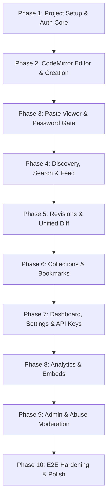

# Paste Platform — Complete Frontend Implementation Plan

> **Document Type:** Production Engineering Blueprint & Implementation Plan  
> **Target Application:** Developer-Centric Pastebin Platform Frontend  
> **Backend Location:** `D:\Personal\paste\Backend` (Express 5, PostgreSQL 16, Redis 7, Prisma 7, BullMQ)  
> **Companion API Matrix:** [`docs/FRONTEND_API_MAPPING.md`](./FRONTEND_API_MAPPING.md)  
> **Author:** Senior Full-Stack Architect & Frontend Engineer  
> **Status:** Inspected, Verified & Ready for Phased Execution

---

## 1. Executive Summary & Architectural Vision

### 1.1 Product Philosophy
The **Paste Platform Frontend** is designed from the ground up as a **high-performance, developer-first tool** optimized for rapid code sharing, inspection, and manipulation. Rather than mimicking bloated, marketing-heavy SaaS applications, it embraces the craft and restraint seen in elite developer utilities: **Linear, Raycast, GitHub Gist, and Vercel**.

Key tenets:
1. **Editor as the Hero:** The code editor is immediate. When landing on the homepage, the cursor is ready, syntax highlighting is active, and paste options are accessible via intuitive shortcuts without modal friction.
2. **Dark-First, High Information Density:** Near-black background canvases (`#09090b`), restrained typography (Geist Sans for UI, JetBrains Mono for code), ultra-subtle zinc borders (`#27272a`), and disciplined violet/indigo accents (`#8b5cf6` / `#6366f1`).
3. **Frictionless Anonymous & Authenticated Workflows:** Full support for unauthenticated instant pastes (with local management credential caching) and authenticated workspaces (collections, bookmarks, personal analytics, API keys, session management).
4. **Zero Compromise Security:** Seamless integration with backend Argon2id password-protected pastes, one-time burn-after-reading enforcement, exact max-view gating, and strict Content Security Policy embeddings.

---

## 2. Comprehensive Backend Capability Audit

The backend repository (`D:\Personal\paste\Backend`) was inspected down to individual controllers, services, middleware, and Prisma schemas.

### 2.1 Backend Core Findings

| Subsystem | Backend Implementation Detail | Frontend Architecture Alignment |
|---|---|---|
| **Database Models** | 17 PostgreSQL tables managed by Prisma 7 (`@prisma/adapter-pg`): `users`, `sessions`, `oauth_accounts`, `auth_tokens`, `pastes`, `paste_revisions`, `paste_view_daily`, `paste_tokens`, `api_keys`, `api_usage`, `collections`, `collection_pastes`, `bookmarks`, `abuse_reports`, `audit_logs`, `user_restrictions`, `ip_bans`. | Frontend domain models map 1:1 to backend types; IDs are either UUIDv7 (`01948...`), 10-char nanoid-style short IDs, or custom slugs (3–64 chars). |
| **Authentication** | Session-based authentication via `__Host-sess` HTTP-only cookie (rolling 30-day idle expiry), Argon2id password hashing, email verification tokens (24h), password reset tokens (1h), and Google/GitHub OAuth with PKCE and state cookies. | Frontend relies on browser cookie transport with `credentials: 'include'`. State is managed via TanStack Query `useCurrentUser()` query hook with optimistic invalidate on login/logout. |
| **Paste Access Matrix** | Three visibility levels: `PUBLIC` (feed & search indexed), `UNLISTED` (link-only), `PRIVATE` (author only or authorized via `share_token`). Expiration is authoritative in PostgreSQL queries (`expires_at IS NULL OR expires_at > now()`). | Visibility selector component with instant visual badges; share token generator modal for private pastes. |
| **Password Protection** | Argon2id paste passwords. Owner or admin bypasses password prompt. Strangers encounter 401 `PASSWORD_REQUIRED` on `GET /pastes/:id`. Unlocked via `POST /pastes/:id/unlock`. | The viewer renders an in-place password unlock gate. Once unlocked, paste content is stored only in React component memory (never written to `localStorage`). |
| **Burn-After-Read & Max Views** | Synchronous atomic consumption. Burn pastes are marked `burned_at = now()` on first authorized read. Max views increments synchronously until cap reached. | Displays distinct visual state: "Burned upon viewing" indicator. Consumed pastes display clean 410 Gone / 404 Not Found envelopes. |
| **Revisions System** | Full snapshot stored per modification in `paste_revisions` (capped at 20, dropping oldest). Backend generates unified diffs on-demand (`diff` library) between any two revision numbers. Restore creates a *new* revision snapshot. | Unified diff viewer with syntax-highlighted additions/deletions. Revisions timeline drawer. Restore action with confirmation. |
| **Collections & Bookmarks** | Collections support custom slugs, private/unlisted/public visibility, manual positioning (`positions: [{ pasteId, position }]`). Bookmarks are a private read-later list with idempotent `PUT`/`DELETE`. | Collections management with drag-and-drop or keyboard-accessible reordering. Instant bookmark toggle button on paste viewer. |
| **Developer API & Quotas** | Programmatic API keys with prefix `pb_` (raw key shown once at creation, hashed in DB). Daily quota enforced in Redis (1,000 req/UTC day). Usage captured in `api_usage` (90-day retention). | API Keys dashboard with copy-once modal, usage chart showing latency and endpoint breakdown, and quota usage bar. |
| **Analytics Engine** | Buffered view counting via Redis flusher (60s interval). Daily aggregations in `paste_view_daily`. Unique visitors calculated via Redis HyperLogLog (`PFADD` / `PFCOUNT`). | 30-day interactive time-series charts using Recharts for daily views and unique visitors. |
| **Embedding** | Server-rendered HTML at `GET /embed/:id` with syntax highlighting (highlight.js) and strict CSP (`default-src 'none'`). | Embed code generator dialog offering theme, line numbering, and range selection. |
| **Administrative UI** | Gated by `role === 'ADMIN'`. Endpoints for system stats, user search & suspension, paste hard-purge, abuse report review/resolve, audit logs, and IP bans. | Dedicated `/admin` workspace route with audit log inspector and report review queue. |

### 2.2 Verified Backend Gaps & Strategic Accommodations

1. **Authenticated User "My Pastes" Endpoint:**  
   - *Backend state:* Backend exposes `GET /users/:username/pastes` which executes `listPublicPastes({ username })` with `publicLiveWhere(now)`. This query strictly filters `visibility: 'PUBLIC'`. The backend does not currently have `GET /users/me/pastes` for listing an authenticated user's own `UNLISTED` or `PRIVATE` pastes.
   - *Frontend Accommodation:* Documented clearly in `FRONTEND_API_MAPPING.md`. For the initial release, the dashboard displays public pastes via `GET /users/:username/pastes` alongside pastes grouped in collections and bookmarks. A future backend patch should add `GET /api/v1/users/me/pastes`.
2. **Anonymous Paste Management Storage:**  
   - *Backend state:* When an unauthenticated user creates a paste, the backend returns a single-use `managementToken` in the response `{ paste: ..., managementToken: "..." }`. The backend has no concept of "listing all pastes by management token".
   - *Frontend Accommodation:* Build a client-side `PasteVault` backed by `localStorage` that records created paste IDs, custom slugs, titles, and their corresponding `managementToken`. This enables anonymous creators to edit or delete their pastes from the same browser without requiring account creation.
3. **Turnstile CAPTCHA Requirement:**  
   - *Backend state:* When `env.CAPTCHA_PROVIDER === 'turnstile'`, anonymous paste creation and registration reject requests missing header `x-captcha-token`.
   - *Frontend Accommodation:* Integrate `@marsidev/react-turnstile` with conditional rendering when site key is supplied in frontend environment.
4. **CSRF Origin Guard:**  
   - *Backend state:* `originGuard` middleware rejects mutating requests from unexpected origins carrying the session cookie with `403 Forbidden`.
   - *Frontend Accommodation:* Development setup uses proxying (`/api/v1` -> backend) to maintain identical origin, and production configuration documents setting `FRONTEND_ORIGIN` in backend `.env`.

---

## 3. Technology Stack Selection & Technical Justifications

### 3.1 Recommended Architecture: Next.js 15 (App Router) + React 19 + TypeScript

```
┌────────────────────────────────────────────────────────────────────────┐
│                        Next.js 15 App Router                           │
│  ┌────────────────────────┐  ┌──────────────────────────────────────┐  │
│  │   Server Components    │  │          Client Components           │  │
│  │  - SEO & Meta Tags     │  │  - Interactive CodeMirror 6 Editor   │  │
│  │  - OpenGraph Previews  │  │  - TanStack Query v5 Data Fetching    │  │
│  │  - Static Layout Shell │  │  - React Hook Form + Zod Forms        │  │
│  └───────────┬────────────┘  │  - Radix UI & Command Palette (⌘K)   │  │
│              │               └──────────────────┬───────────────────┘  │
└──────────────┼──────────────────────────────────┼──────────────────────┘
               │                                  │
               ▼                                  ▼
┌────────────────────────────────────────────────────────────────────────┐
│                 Nginx Reverse Proxy / Vite Dev Proxy                   │
│         Route `/api/v1/*` → http://127.0.0.1:3000                      │
│         Route `/*`        → Next.js Node Service / Static Output       │
└──────────────────────────────────┬─────────────────────────────────────┘
                                   │
                                   ▼
┌────────────────────────────────────────────────────────────────────────┐
│                     Express 5 Backend Monolith                         │
└────────────────────────────────────────────────────────────────────────┘
```

#### Why Next.js 15 App Router over Plain Vite SPA?
1. **Developer Link Sharing & Dynamic OpenGraph (Crucial for Pastebins):** When sharing a paste on Discord, Slack, or X/Twitter, having server-generated `<meta property="og:title">`, syntax descriptions, and language tags drastically improves the developer UX. A pure client-rendered SPA renders blank previews.
2. **First-Class Geist Typography:** Zero layout shift and optimal font performance via `next/font/google` (`Geist` and `Geist Mono`).
3. **Seamless API Proxy & Cookies:** Next.js Route Handlers / Rewrites eliminate cross-origin cookie restrictions during local development and simplify production deploys.
4. **Fast Initial Paint with Hybrid Rendering:** Static layouts and server-hydrated viewer headers stream in instantly while the interactive CodeMirror 6 editor loads lazily.

---

### 3.2 Editor Engine Evaluation: CodeMirror 6 vs Monaco Editor

A deep evaluation was conducted to decide between Monaco Editor (VS Code core) and CodeMirror 6.

| Dimension | Monaco Editor | CodeMirror 6 | Architectural Decision |
|---|---|---|---|
| **Bundle Impact** | **~2.5 MB to 4.2 MB** gzipped. Requires complex web worker bundling (`monaco-editor-webpack-plugin` or worker script setup). | **~150 KB to 280 KB** gzipped including core languages and themes. Modular and tree-shakable. | **CodeMirror 6 is 10x leaner**, ensuring the homepage editor renders instantaneously. |
| **Initial Load & TTI** | Heavy main-thread script evaluation overhead. Sluggish on low-power devices. | Sub-50ms instantiation. Near-instant Time to Interactive. | **CodeMirror 6 wins** for a snappy, lightweight developer tool. |
| **Mobile & Touch UX** | Not designed for mobile touch. Virtual keyboard input causes cursor misalignment and layout bugs. | Built on modern `contenteditable` standard; native touch scrolling and virtual keyboard handling. | **CodeMirror 6 wins** — pastes can be created and reviewed smoothly on tablets and phones. |
| **Syntax Highlighting & Language Support** | Excellent out-of-the-box Monaco tokenizers. | First-class Lezer grammars (`@codemirror/lang-javascript`, `python`, `rust`, `go`, `cpp`, `html`, `css`, `sql`, `json`, `markdown`). | Both satisfy developer language requirements. |
| **Diffing & Revisions** | Built-in side-by-side diff editor. | Dedicated `@codemirror/merge` package providing unified and chunk-based diff displays. | **CodeMirror 6 provides clean unified diffing** matching GitHub's diff presentation. |
| **Theming & Design Integration** | Difficult to restyle outer chrome; fixed UI patterns. | Highly customizable via JavaScript theme extensions matching our exact dark zinc/violet palette. | **CodeMirror 6 integrates cleanly** with custom Tailwind CSS themes. |

> **Final Decision: CodeMirror 6** is selected as the core editor and diff engine. It provides the ideal balance of performance, minimal bundle overhead, mobile capability, and customization.

---

### 3.3 Core Supporting Libraries

- **Styling:** `tailwindcss` v4 + `tailwind-merge` + `clsx`
- **Component Primitives:** `shadcn/ui` (built on `@radix-ui/react-*`)
- **Icons:** `lucide-react`
- **Data Fetching & Server State:** `@tanstack/react-query` v5 + `@tanstack/react-query-devtools`
- **Forms & Validation:** `react-hook-form` + `@hookform/resolvers` + `zod` (v3.23)
- **Code Highlighting & Diffs:** `@codemirror/view`, `@codemirror/state`, `@codemirror/merge`, `@codemirror/language`, Lezer language packs
- **Diff Parsing:** `diff` / `parse-diff` for converting backend unified diff strings into interactive chunk views
- **Charts & Data Visualization:** `recharts` for 30-day analytics time series
- **Toast Notifications:** `sonner` (minimal, dark-mode first toasts)
- **Command Palette:** `cmdk` for `⌘K` global quick actions

---

## 4. Design System & Developer Aesthetic

### 4.1 Visual Theme Tokens

Inspired by Linear, Raycast, and Vercel, the design uses a disciplined dark palette:

```css
:root {
  /* Canvas & Backgrounds */
  --bg-app: #09090b;        /* Main background (zinc-950) */
  --bg-canvas: #0c0c0e;     /* Editor canvas & card surface */
  --bg-subtle: #141417;     /* Hover states & secondary panels */
  --bg-muted: #1c1c21;      /* Dropdowns, toolbars, badges */
  
  /* Borders & Dividers */
  --border-subtle: #1f1f23; /* Outer section boundaries */
  --border-muted: #27272a;  /* Card borders, editor splitters */
  --border-focus: #3f3f46;  /* Focused inputs, active tabs */
  
  /* Text & Foreground */
  --fg-primary: #f4f4f5;   /* Headings, code text, active labels (zinc-100) */
  --fg-secondary: #a1a1aa; /* Secondary metadata, descriptions (zinc-400) */
  --fg-muted: #71717a;     /* Line numbers, placeholders, timestamps (zinc-500) */
  
  /* Accents & Signals */
  --accent-violet: #8b5cf6; /* Primary brand actions & active states */
  --accent-indigo: #6366f1; /* Secondary highlight */
  --signal-success: #10b981;/* Copied, active status */
  --signal-warning: #f59e0b;/* Burn warning, expiring soon */
  --signal-danger: #ef4444; /* Purge, delete, errors */
}
```

### 4.2 Typography System

- **UI Sans:** `Geist Sans` (`font-sans`), tracking `-0.01em`, weights: `400` (regular), `500` (medium), `600` (semibold).
- **Code Mono:** `JetBrains Mono` or `Geist Mono` (`font-mono`), ligatures enabled, line-height `1.5`, tab size `2` or `4` user-configurable.

### 4.3 Component Density & Ergonomics
- Strict avoidance of oversized hero banners, unnecessary illustrations, and decorative gradient blobs.
- Compact toolbar heights (36px–40px), dense table rows (36px), and persistent keyboard shortcuts:
  - `⌘ + Enter` / `Ctrl + Enter`: Submit / Create Paste
  - `⌘ + K` / `Ctrl + K`: Open Command Palette (jump to pastes, languages, settings)
  - `⌘ + C` / `Ctrl + C`: Copy raw paste content or selection
  - `Esc`: Close drawers, modals, diff viewer

---

## 5. Complete Page & Route Inventory

The frontend architecture defines 15 distinct screens matching all backend capabilities:

| # | Route | Page Title | Access | Description & Key Components |
|---|---|---|---|---|
| **1** | `/` | **Paste — Instant Editor** | Public | Immediate homepage paste editor. Clean header, full-bleed CodeMirror 6 canvas, sticky bottom action bar (Language, Visibility, Expiration, Password toggle, Create button). |
| **2** | `/new` | **New Paste** | Public | Alias / dedicated route for new paste creation with expanded metadata drawer (Title, Description, Custom Slug, Max Views, Burn-after-read). |
| **3** | `/p/[id]` | **View Paste** | Public / Gated | Main paste viewer. Displays title, metadata bar (lines, bytes, views, author, expiration), action buttons (Copy, Raw, Download, Fork, Bookmark, Share, Revisions, Report). Includes in-memory password unlock card. |
| **4** | `/p/[id]/raw` | **Raw Content** | Public / Gated | Clean plain-text delivery of paste content (proxies or directs to `GET /api/v1/pastes/:id/raw`). |
| **5** | `/dashboard` | **Developer Dashboard** | Authenticated | Personal hub: 30-day view analytics card, storage used counter, quick-create shortcut, recent pastes list, active collections widget, bookmarks shortcut. |
| **6** | `/my-pastes` | **My Pastes** | Authenticated | Keyset-paginated table of author's pastes. Search by title, filter by language and sort order (Latest, Popular, Trending). Includes anonymous pastes stored in local `PasteVault`. |
| **7** | `/p/[id]/revisions` | **Revision History & Diffs** | Public / Gated | Timeline drawer of past snapshots (1 to N). Interactive diff viewer showing visual unified diff against any selected baseline revision with "Restore" action. |
| **8** | `/collections` & `/collections/[id]` | **Collections & Bookmarks** | Authenticated / Public | Grid of user collections (Public, Unlisted, Private). Collection detail view with drag-and-drop paste reordering and quick bookmark drawer. |
| **9** | `/explore` | **Explore Public Pastes** | Public | Community discovery feed. Keyset-paginated stream sorted by Latest, Popular, or Trending, with sidebar language facets and full-text search. |
| **10** | `/login`, `/register`, `/forgot-password`, `/reset-password` | **Authentication** | Public (Guest) | Minimalist auth screens with email/password and OAuth (GitHub/Google) buttons. Turnstile CAPTCHA integration. |
| **11** | `/settings` | **Account Settings** | Authenticated | Tabbed configuration: Profile (Display Name, Bio, Avatar, Website), Active Sessions manager (with remote revocation), and Danger Zone (Account deletion). |
| **12** | `/settings/api-keys` | **Developer API Keys** | Authenticated | API key generator with one-time raw secret reveal, active keys table, and 30-day quota & usage analytics graph. |
| **13** | `/analytics` & `/p/[id]/stats` | **Analytics** | Authenticated | Comprehensive metrics: Overall account analytics and per-paste deep dive showing daily views and HyperLogLog unique visitors. |
| **14** | `/embed/[id]` | **Embedded Viewer** | Public / Share Token | Clean, isolated embed frame view (or generator modal providing iframe snippets configured with theme, line numbers, and range). |
| **15** | `/admin` | **Administration & Moderation** | Admin Only | System metrics, user search & suspension, paste hard-purge, abuse reports queue with 1-click auto-unlisting, audit logs, and IP bans manager. |

---

## 6. Detailed Component Architecture & Hierarchy

```
src/
├── app/                              # Next.js 15 App Router pages & layouts
│   ├── layout.tsx                    # Root layout (Geist font, ThemeProvider, QueryClientProvider)
│   ├── page.tsx                      # Homepage with immediate editor
│   ├── (auth)/                       # Auth group layout (minimal card container)
│   │   ├── login/page.tsx
│   │   ├── register/page.tsx
│   │   ├── forgot-password/page.tsx
│   │   ├── reset-password/page.tsx
│   │   └── auth/callback/page.tsx    # OAuth callback handler
│   ├── (dashboard)/                  # Authenticated workspace layout with sidebar
│   │   ├── dashboard/page.tsx
│   │   ├── my-pastes/page.tsx
│   │   ├── collections/
│   │   │   ├── page.tsx
│   │   │   └── [id]/page.tsx
│   │   ├── bookmarks/page.tsx
│   │   ├── analytics/page.tsx
│   │   └── settings/
│   │       ├── page.tsx
│   │       ├── sessions/page.tsx
│   │       └── api-keys/page.tsx
│   ├── p/                            # Paste viewer routes
│   │   ├── [id]/
│   │   │   ├── page.tsx              # Main viewer
│   │   │   ├── edit/page.tsx         # Update paste
│   │   │   └── revisions/page.tsx    # Revisions & diff view
│   ├── explore/page.tsx              # Public feed & discovery
│   ├── u/[username]/page.tsx         # Public user profile & public pastes
│   ├── embed/[id]/page.tsx           # Embed route
│   └── admin/                        # Admin workspace (protected by role=ADMIN)
│       ├── page.tsx
│       ├── users/page.tsx
│       ├── pastes/page.tsx
│       ├── reports/page.tsx
│       ├── audit/page.tsx
│       └── bans/page.tsx
│
├── components/
│   ├── editor/                       # Core CodeMirror 6 Editor
│   │   ├── code-editor.tsx           # Primary CodeMirror wrapper
│   │   ├── editor-toolbar.tsx        # Top toolbar (language, stats, formatting)
│   │   ├── editor-statusbar.tsx      # Bottom bar (lines, chars, cursor pos)
│   │   ├── editor-settings-sheet.tsx # Advanced settings (password, burn, max views, slug)
│   │   └── language-select.tsx       # Searchable language selector
│   │
│   ├── viewer/                       # Paste Viewer Components
│   │   ├── paste-viewer.tsx          # Full viewer assembly
│   │   ├── paste-header.tsx          # Title, author badge, timestamp, metrics
│   │   ├── paste-actions.tsx         # Action button group (copy, raw, download, fork)
│   │   ├── code-display.tsx          # Read-only syntax highlighted code with line links
│   │   ├── password-gate.tsx         # In-place unlock form for protected pastes
│   │   ├── burn-notice.tsx           # Burn-after-reading banner
│   │   ├── share-dialog.tsx          # Share token generator & URL copier
│   │   └── report-dialog.tsx         # Abuse report submission modal
│   │
│   ├── revisions/                    # Revision & Diff Engine
│   │   ├── revision-timeline.tsx     # Vertical snapshot list
│   │   ├── diff-viewer.tsx           # Unified diff component using @codemirror/merge
│   │   ├── revision-snapshot.tsx     # Read-only snapshot viewer
│   │   └── restore-dialog.tsx        # Restore confirmation modal
│   │
│   ├── discovery/                    # Feed & Search
│   │   ├── paste-feed.tsx            # Infinite scroll list of PasteCards
│   │   ├── paste-card.tsx            # Individual feed item (title, snippet, author, views)
│   │   ├── search-bar.tsx            # Debounced search input
│   │   └── language-facets.tsx       # Sidebar facet list with counts
│   │
│   ├── collections/                  # Collections & Bookmarks
│   │   ├── collection-card.tsx
│   │   ├── collection-items-list.tsx # Sortable paste list
│   │   └── add-to-collection-modal.tsx
│   │
│   ├── settings/                     # User & Developer Settings
│   │   ├── profile-form.tsx
│   │   ├── sessions-table.tsx
│   │   ├── api-keys-table.tsx
│   │   ├── new-api-key-modal.tsx
│   │   └── api-usage-chart.tsx
│   │
│   ├── admin/                        # Admin Moderation Tools
│   │   ├── admin-metrics.tsx
│   │   ├── reports-queue.tsx
│   │   ├── user-moderation-row.tsx
│   │   └── audit-log-table.tsx
│   │
│   ├── layout/                       # Global Layout Chrome
│   │   ├── site-header.tsx           # Top navigation bar
│   │   ├── site-footer.tsx           # Minimal developer footer
│   │   ├── user-nav.tsx              # User avatar & dropdown
│   │   └── command-palette.tsx       # ⌘K quick switcher
│   │
│   └── ui/                           # shadcn/ui primitives
│       ├── button.tsx, dialog.tsx, dropdown-menu.tsx, input.tsx,
│       ├── sheet.tsx, table.tsx, tooltip.tsx, badge.tsx, tabs.tsx
│
├── lib/                              # Client utilities & core services
│   ├── api/                          # Strongly typed API client
│   │   ├── client.ts                 # Axios / fetch wrapper with credentials
│   │   ├── auth.ts                   # Auth API methods
│   │   ├── pastes.ts                 # Paste CRUD, unlock, fork, share tokens
│   │   ├── revisions.ts              # Revisions list, diff, restore
│   │   ├── collections.ts            # Collections & bookmarks
│   │   ├── discovery.ts              # Feeds, search, languages
│   │   ├── user.ts                   # Profile, sessions, analytics
│   │   └── admin.ts                  # Admin operations
│   ├── editor/                       # CodeMirror configuration
│   │   ├── extensions.ts             # Line numbers, active line, bracket matching
│   │   ├── languages.ts              # Language loader map (Lezer grammars)
│   │   └── themes.ts                 # Custom dark theme definition
│   ├── hooks/                        # Custom React hooks
│   │   ├── use-auth.ts               # User session state & queries
│   │   ├── use-paste-vault.ts        # LocalStorage anonymous paste vault
│   │   ├── use-clipboard.ts          # Safe copy-to-clipboard with toast
│   │   └── use-keyboard-shortcuts.ts # Global hotkey listeners
│   └── utils.ts                      # Byte formatting, date formatting, cn()
```

---

## 7. Editor Experience Architecture & Deep Dive

The CodeMirror 6 editor is engineered to deliver a fluid desktop and mobile developer experience:

### 7.1 Editor Core Configuration (`src/lib/editor/extensions.ts`)
- **Core Extensions:**
  - `lineNumbers()`: Compact, non-selectable line gutter with subtle coloring (`#52525b`).
  - `highlightActiveLineGutter()`, `highlightActiveLine()`: Subtle background highlighting (`#141417`).
  - `history()` + `keymap.of(defaultKeymap, historyKeymap, indentWithTab)`: Standard undo/redo and indentation behavior.
  - `bracketMatching()`, `closeBrackets()`: Automated paired delimiter management.
  - `syntaxHighlighting(defaultHighlightStyle)`: Semantic coloring optimized for dark background.
  - `EditorView.lineWrapping`: Enabled by default with toggle option.
  - `EditorView.theme`: Custom theme ensuring full height filling, clean scrollbars, and zero outline on focus.

### 7.2 Language Loading & Auto-Detection Strategy
- **Supported Highlighters (Lazy Loaded):**
  - JavaScript / TypeScript (`@codemirror/lang-javascript`)
  - Python (`@codemirror/lang-python`)
  - Rust (`@codemirror/lang-rust`)
  - Go (`@codemirror/lang-go`)
  - C / C++ (`@codemirror/lang-cpp`)
  - HTML / XML (`@codemirror/lang-html`, `@codemirror/lang-xml`)
  - CSS / SCSS (`@codemirror/lang-css`)
  - SQL (`@codemirror/lang-sql`)
  - JSON (`@codemirror/lang-json`)
  - Markdown (`@codemirror/lang-markdown`)
  - YAML (`@codemirror/lang-yaml`)
  - Plain Text (Fallback)
- **Automatic Language Detection:**
  - Client performs instant heuristic check on initial paste input (shebangs `#!\s*\/usr\/bin\/python`, `package main`, `fn main()`, `<html`, `SELECT ... FROM`) to dynamically switch editor grammar if user hasn't explicitly selected one.
  - Matches backend `detectLanguage` heuristic algorithm (`src/lib/language-detect.ts`).

### 7.3 Advanced Settings Drawer
A collapsible slide-over drawer (`EditorSettingsSheet`) exposes secondary paste configurations:
- **Title & Description:** Clean inputs for descriptive metadata.
- **Custom Slug:** Live validator testing against regex `/^[a-z0-9_-]{3,64}$/` and reserved word list (`admin`, `api`, `paste`, `explore`, etc.).
- **Visibility:** Segmented button selector (`Public`, `Unlisted`, `Private`).
- **Expiration:** Dropdown presets (`10m`, `1h`, `1d`, `1w`, `1m`, `Never`) or custom calendar date picker.
- **Password Protection:** Masked password field with strength indicator.
- **Burn-After-Read:** Toggle with clear warning modal explaining destructive behavior.
- **Max Views:** Numeric input (1 to 1,000,000) for exact view counting caps.

---

## 8. State Management & API Integration Strategy

### 8.1 State Division

| State Scope | Management Tool | Description |
|---|---|---|
| **Server State** | TanStack Query v5 | User profile, paste data, feeds, collections, revisions, API keys, admin queues. Automatic stale-time management, background refetching, and keyset cursor pagination. |
| **Local Session State** | React Context (`AuthContext`) | Holds authenticated user object derived from `GET /api/v1/users/me`. Provides `login()`, `logout()`, and role checks. |
| **Anonymous Paste Vault** | Browser `localStorage` | Securely stores array of `{ id, customSlug, title, managementToken, createdAt }` for anonymous creations on that device. |
| **Unlocked Paste Content** | Component Memory (`useState`) | Content retrieved via `POST /pastes/:id/unlock` is held strictly in component state and purged on navigation to prevent secret leaking. |
| **Editor Draft State** | Browser `sessionStorage` | Auto-saves uncommitted editor buffer to prevent accidental loss on page refresh. |

### 8.2 Keyset Pagination with TanStack Query
For `/explore`, `/search`, and `/u/:username/pastes`, the frontend implements `useInfiniteQuery`:

```typescript
export function usePublicFeed(sort: 'latest' | 'popular' | 'trending', language?: string) {
  return useInfiniteQuery({
    queryKey: ['pastes', 'feed', sort, language],
    queryFn: async ({ pageParam }) => {
      const res = await apiClient.get('/pastes', {
        params: { sort, language, cursor: pageParam, limit: 20 },
      });
      return res.data;
    },
    initialPageParam: undefined as string | undefined,
    getNextPageParam: (lastPage) => (lastPage.pagination.hasMore ? lastPage.pagination.cursor : undefined),
    staleTime: 30_000, // 30 seconds
  });
}
```

---

## 9. Complete Frontend Directory Structure

```
paste-frontend/
├── public/
│   ├── favicon.ico
│   ├── og-image.png
│   └── robots.txt
├── src/
│   ├── app/
│   │   ├── (auth)/
│   │   │   ├── layout.tsx
│   │   │   ├── login/page.tsx
│   │   │   ├── register/page.tsx
│   │   │   ├── forgot-password/page.tsx
│   │   │   ├── reset-password/page.tsx
│   │   │   └── auth/callback/page.tsx
│   │   ├── (dashboard)/
│   │   │   ├── layout.tsx
│   │   │   ├── dashboard/page.tsx
│   │   │   ├── my-pastes/page.tsx
│   │   │   ├── collections/
│   │   │   │   ├── page.tsx
│   │   │   │   └── [id]/page.tsx
│   │   │   ├── bookmarks/page.tsx
│   │   │   ├── analytics/page.tsx
│   │   │   └── settings/
│   │   │       ├── page.tsx
│   │   │       ├── sessions/page.tsx
│   │   │       └── api-keys/page.tsx
│   │   ├── admin/
│   │   │   ├── layout.tsx
│   │   │   ├── page.tsx
│   │   │   ├── users/page.tsx
│   │   │   ├── pastes/page.tsx
│   │   │   ├── reports/page.tsx
│   │   │   ├── audit/page.tsx
│   │   │   └── bans/page.tsx
│   │   ├── p/
│   │   │   ├── [id]/
│   │   │   │   ├── page.tsx
│   │   │   │   ├── raw/route.ts
│   │   │   │   └── revisions/page.tsx
│   │   ├── u/
│   │   │   └── [username]/page.tsx
│   │   ├── explore/page.tsx
│   │   ├── embed/
│   │   │   └── [id]/page.tsx
│   │   ├── verified/page.tsx
│   │   ├── layout.tsx
│   │   ├── page.tsx
│   │   └── not-found.tsx
│   ├── components/
│   │   ├── admin/
│   │   ├── analytics/
│   │   ├── auth/
│   │   ├── collections/
│   │   ├── discovery/
│   │   ├── editor/
│   │   ├── layout/
│   │   ├── revisions/
│   │   ├── settings/
│   │   ├── ui/
│   │   └── viewer/
│   ├── hooks/
│   │   ├── use-auth.ts
│   │   ├── use-clipboard.ts
│   │   ├── use-debounce.ts
│   │   ├── use-keyboard-shortcuts.ts
│   │   └── use-paste-vault.ts
│   ├── lib/
│   │   ├── api/
│   │   │   ├── client.ts
│   │   │   ├── auth.ts
│   │   │   ├── pastes.ts
│   │   │   ├── revisions.ts
│   │   │   ├── collections.ts
│   │   │   ├── discovery.ts
│   │   │   ├── user.ts
│   │   │   └── admin.ts
│   │   ├── editor/
│   │   │   ├── extensions.ts
│   │   │   ├── languages.ts
│   │   │   └── themes.ts
│   │   ├── constants.ts
│   │   └── utils.ts
│   ├── styles/
│   │   └── globals.css
│   └── types/
│       ├── api.ts
│       ├── editor.ts
│       └── models.ts
├── .env.example
├── next.config.mjs
├── package.json
├── postcss.config.mjs
├── tailwind.config.ts
└── tsconfig.json
```

---

## 10. Dependency Recommendations (`package.json`)

The following dependencies are selected for production readiness, minimal overhead, and compatibility:

```json
{
  "name": "paste-frontend",
  "version": "1.0.0",
  "private": true,
  "scripts": {
    "dev": "next dev",
    "build": "next build",
    "start": "next start",
    "lint": "eslint . --max-warnings 0",
    "typecheck": "tsc --noEmit"
  },
  "dependencies": {
    "@codemirror/commands": "^6.8.0",
    "@codemirror/language": "^6.10.8",
    "@codemirror/merge": "^6.7.3",
    "@codemirror/state": "^6.5.2",
    "@codemirror/view": "^6.36.2",
    "@codemirror/lang-cpp": "^6.0.2",
    "@codemirror/lang-css": "^6.3.1",
    "@codemirror/lang-go": "^6.0.1",
    "@codemirror/lang-html": "^6.4.9",
    "@codemirror/lang-javascript": "^6.2.2",
    "@codemirror/lang-json": "^6.0.1",
    "@codemirror/lang-markdown": "^6.3.2",
    "@codemirror/lang-python": "^6.1.6",
    "@codemirror/lang-rust": "^6.0.2",
    "@codemirror/lang-sql": "^6.8.0",
    "@codemirror/lang-xml": "^6.1.0",
    "@codemirror/lang-yaml": "^6.1.1",
    "@hookform/resolvers": "^3.9.1",
    "@marsidev/react-turnstile": "^1.1.0",
    "@radix-ui/react-alert-dialog": "^1.1.2",
    "@radix-ui/react-avatar": "^1.1.1",
    "@radix-ui/react-dialog": "^1.1.2",
    "@radix-ui/react-dropdown-menu": "^2.1.2",
    "@radix-ui/react-popover": "^1.1.2",
    "@radix-ui/react-select": "^2.1.2",
    "@radix-ui/react-separator": "^1.1.0",
    "@radix-ui/react-sheet": "^1.1.2",
    "@radix-ui/react-slot": "^1.1.0",
    "@radix-ui/react-tabs": "^1.1.1",
    "@radix-ui/react-tooltip": "^1.1.4",
    "@tanstack/react-query": "^5.62.0",
    "axios": "^1.7.9",
    "class-variance-authority": "^0.7.1",
    "clsx": "^2.1.1",
    "cmdk": "^1.0.4",
    "date-fns": "^4.1.0",
    "diff": "^7.0.0",
    "lucide-react": "^0.468.0",
    "next": "15.1.0",
    "react": "^19.0.0",
    "react-dom": "^19.0.0",
    "react-hook-form": "^7.54.0",
    "recharts": "^2.15.0",
    "sonner": "^1.7.1",
    "tailwind-merge": "^2.5.5",
    "tailwindcss-animate": "^1.0.7",
    "zod": "^3.24.1"
  },
  "devDependencies": {
    "@types/diff": "^6.0.0",
    "@types/node": "^22.10.1",
    "@types/react": "^19.0.1",
    "@types/react-dom": "^19.0.1",
    "eslint": "^9.16.0",
    "eslint-config-next": "15.1.0",
    "postcss": "^8.4.49",
    "tailwindcss": "^3.4.16",
    "typescript": "^5.7.2"
  }
}
```

---

## 11. Phased Implementation Roadmap

Development is sequenced into 10 dependency-ordered phases. Each phase culminates in an explicit verification gate so implementation proceeds predictably.



### Phase 1: Foundation, Design Tokens, API Client & Auth
- **Features:** Next.js 15 scaffolding, Tailwind CSS theme tokens (dark-first), shadcn/ui base primitives, Axios API client with cookie handling, full authentication flow (Register, Login, Logout, Forgot Password, Reset Password, OAuth callback).
- **Routes:** `/login`, `/register`, `/forgot-password`, `/reset-password`, `/auth/callback`, `/verified`.
- **API Integrations:** `POST /auth/register`, `POST /auth/login`, `POST /auth/logout`, `GET /auth/oauth/:provider`, `GET /users/me`.
- **Acceptance Criteria:**
  - Authenticated session cookie (`__Host-sess`) stored and sent with credentials.
  - User can sign up, log in, view their username in the header, and log out.
  - Auth queries cached in TanStack Query; unauthenticated states degrade gracefully to guest mode.

### Phase 2: Core Editor Experience & Paste Creation
- **Features:** Homepage instant editor, CodeMirror 6 integration, language selector, line numbers, status bar (lines, characters, byte size counter), quick-create shortcut (`⌘+Enter`), advanced settings drawer (custom slug, visibility, expiration presets, password, burn-after-read, max views), anonymous `PasteVault` storage.
- **Routes:** `/` (Home), `/new`.
- **API Integrations:** `POST /pastes` (with `Idempotency-Key` and `x-captcha-token`).
- **Acceptance Criteria:**
  - Cursor is immediately focused in editor upon page load.
  - Creating a paste validates client-side against 1 MB byte limit and reserved slugs.
  - Anonymous paste returns `managementToken`, which is stored in `PasteVault` and displayed with a copy warning.
  - Redirects smoothly to `/p/:id` on creation.

### Phase 3: Paste Viewer & Access Gating
- **Features:** Syntax highlighted read-only code display, clickable line numbers with anchor linking (`#L10-L25`), action bar (Copy to clipboard, Raw, Download, Fork, Share dialog), in-memory password unlock card, burn-after-reading banner.
- **Routes:** `/p/[id]`, `/p/[id]/raw`, `/p/[id]/download`.
- **API Integrations:** `GET /pastes/:id`, `POST /pastes/:id/unlock`, `POST /pastes/:id/fork`, `POST /pastes/:id/share-tokens`, `DELETE /pastes/:id`.
- **Acceptance Criteria:**
  - Clean syntax highlighting matching CodeMirror theme.
  - Protected pastes prompt for password; entering correct password renders content in-memory without refreshing.
  - Burn-after-read pastes alert user that content will not be accessible upon reload.
  - Line clicking copies permalink with highlight range.

### Phase 4: Discovery, Search & Keyset Feeds
- **Features:** Public exploration feed (`/explore`) with tabs (Latest, Popular, Trending), language filter sidebar, full-text search with debounce, keyset cursor pagination with infinite scroll.
- **Routes:** `/explore`.
- **API Integrations:** `GET /pastes` (with cursor & sort), `GET /search`, `GET /languages`.
- **Acceptance Criteria:**
  - Infinite scroll fetches subsequent pages using base64url keyset cursor.
  - Language filter updates URL query parameters and invalidates feed query.
  - Search queries execute against backend `tsvector` index with clean empty states.

### Phase 5: Snapshot Revisions & Visual Diff Viewer
- **Features:** Revision history timeline drawer, snapshot inspector, unified diff calculation using `@codemirror/merge` and backend diff endpoint, revision restore confirmation.
- **Routes:** `/p/[id]/revisions`.
- **API Integrations:** `GET /pastes/:id/revisions`, `GET /pastes/:id/revisions/:no`, `GET /pastes/:id/revisions/:no/diff?to=:to`, `POST /pastes/:id/revisions/:no/restore`.
- **Acceptance Criteria:**
  - Selecting two revisions shows color-coded unified diff (+ green, - red).
  - Restoring a revision successfully triggers `POST .../restore` with owner session or `x-management-token`, creating revision N+1.

### Phase 6: Collections & Bookmarks
- **Features:** User collections grid, collection creation/edit/delete modal, drag-and-drop paste reordering, bookmark toggle on paste viewer, dedicated bookmarks table.
- **Routes:** `/collections`, `/collections/[id]`, `/bookmarks`.
- **API Integrations:** `GET /collections`, `POST /collections`, `GET /collections/:id`, `PATCH /collections/:id`, `DELETE /collections/:id`, `POST /collections/:id/pastes`, `PATCH /collections/:id/pastes`, `PUT /pastes/:id/bookmark`, `DELETE /pastes/:id/bookmark`, `GET /users/me/bookmarks`.
- **Acceptance Criteria:**
  - Users can create named collections and organize pastes.
  - Reordering sends updated `positions` array to backend.
  - Bookmarks can be added/removed with instant optimistic UI update.

### Phase 7: User Dashboard, Account Settings & API Keys
- **Features:** Developer dashboard overview, profile update form, active sessions manager with remote revocation, danger zone (account deletion), API keys generator with one-time reveal, API usage summary chart.
- **Routes:** `/dashboard`, `/my-pastes`, `/settings`, `/settings/sessions`, `/settings/api-keys`.
- **API Integrations:** `GET /users/me`, `PATCH /users/me`, `DELETE /users/me`, `GET /users/me/sessions`, `DELETE /users/me/sessions/:id`, `DELETE /users/me/sessions`, `POST /api-keys`, `GET /api-keys`, `DELETE /api-keys/:id`, `GET /users/me/api-usage`.
- **Acceptance Criteria:**
  - Sessions table displays current browser IP and user agent with "Revoke" action.
  - Generated API key shows raw `pb_...` key once with copy button.
  - Usage bar renders daily quota consumption (out of 1,000 req/day).

### Phase 8: Analytics & Embeddable Paste Viewer
- **Features:** Interactive 30-day analytics charts (Recharts) for user account and individual pastes (views and HyperLogLog unique visitors), embed configurator modal (theme, lines, range), standalone embed iframe route.
- **Routes:** `/analytics`, `/p/[id]/stats`, `/embed/[id]`.
- **API Integrations:** `GET /users/me/analytics`, `GET /pastes/:id/stats`, `GET /embed/:id`.
- **Acceptance Criteria:**
  - Area / bar charts display daily view trends.
  - Embed preview renders responsive iframe matching selected parameters.

### Phase 9: Administration & Moderation
- **Features:** Admin dashboard (protected by `role === 'ADMIN'`), system stats widgets, user search & suspension modal, paste search & hard purge, abuse reports review queue with one-click resolution (`delete_paste` / `dismiss`), audit log viewer, IP bans manager.
- **Routes:** `/admin`, `/admin/users`, `/admin/pastes`, `/admin/reports`, `/admin/audit`, `/admin/bans`.
- **API Integrations:** All `/admin/*` endpoints.
- **Acceptance Criteria:**
  - Non-admin users attempting to access `/admin` receive 404 or redirect.
  - Resolving an abuse report with `delete_paste` tombstones the paste and updates the report queue.

### Phase 10: Performance Optimization, Keyboard Navigation & Polish
- **Features:** Command Palette (`⌘K`) for rapid navigation, global keyboard shortcuts, bundle size optimization (dynamic imports for code languages), offline draft auto-save, toast notifications with Sonner.
- **Acceptance Criteria:**
  - Lighthouse performance score > 95 on desktop and mobile.
  - Keyboard navigation allows creating and sharing a paste without touching the mouse.

---

## 12. Verification and Operational Runbook

### 12.1 Local Development Setup

1. **Verify Backend Stack Running:**
   ```bash
   cd D:\Personal\paste\Backend
   docker compose up -d    # PostgreSQL, Redis, MailHog
   npm run dev             # API on port 3000
   ```
2. **Frontend Initialization:**
   ```bash
   cd D:\Personal\paste
   # Frontend directory setup
   npx create-next-app@latest frontend --typescript --tailwind --eslint --app --src-dir --import-alias "@/*"
   cd frontend
   npm install @tanstack/react-query @codemirror/view @codemirror/state @codemirror/merge axios lucide-react sonner zod react-hook-form
   ```
3. **Configure Environment Variables (`frontend/.env.local`):**
   ```env
   NEXT_PUBLIC_API_URL=http://localhost:3000/api/v1
   NEXT_PUBLIC_APP_URL=http://localhost:3001
   # Optional: Cloudflare Turnstile Key if CAPTCHA enabled on backend
   NEXT_PUBLIC_TURNSTILE_SITE_KEY=
   ```
4. **Backend `.env` alignment:** Ensure `FRONTEND_ORIGIN=http://localhost:3001` (or matching port) in `Backend/.env` to satisfy `originGuard` and CORS credentials.

---

## 13. Summary

With this implementation plan and the companion [`FRONTEND_API_MAPPING.md`](./FRONTEND_API_MAPPING.md), the entire frontend architecture is mapped to the backend. An engineer or coding agent can now implement each phase sequentially with full confidence in contract adherence, security policies, and developer-grade user experience.
